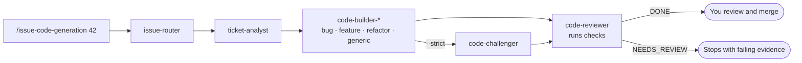

[](https://github.com/koydas/ai-dev-tools/actions/workflows/ci.yml)

# ai-dev-tools

**Claude Code agents that run your tests before they call a patch done.**

An interactive issue-to-patch pipeline for Claude Code: you type one command, a chain of specialized agents analyzes the issue, writes the patch, attacks it, and reviews it against **executed** checks — then stops at you. Nothing is committed, pushed or merged without a human. For the headless GitHub Actions counterpart, see [`autonomous-dev-loop`](https://github.com/koydas/autonomous-dev-loop).

| | |
|---|---|
| **Evidence, not opinion** | The reviewer runs the repo's own tests, lint and type-check (discovered from `CLAUDE.md`, CI workflows and manifests — never invented) and re-executes the builder's evidence. `DONE` requires every row of its Evidence table to be `PASS`, `N/A` or `PRE_EXISTING`. [ADR-009](docs/adr/ADR-009-tool-grounded-review.md) |
| **A red main doesn't block your PR — or hide** | A failure is `PRE_EXISTING` only if the merge-base's CI failed the same check, with the run URL cited. The base CI results are fetched by a script (`gh-get-check-runs.mjs`), not recalled by the model; the agent matches them and, in doubt, it's `FAIL`. |
| **Bug fixes must prove the bug** | Issues are routed to a bug, feature or refactor builder. The bug builder must ship a reproduction test that fails before the fix; the refactor builder must show non-regression. |
| **Adversarial pass on demand** | `--strict` adds a `code-challenger` agent whose only job is to break the patch before review. |
| **Never touches your tree behind your back** | Patches land uncommitted; agents never checkout, stash, reset or clean. Fork PRs execute nothing without your explicit approval. |
| **Resumable** | Up to five checkpoints per run (four without `--strict`); `/resume` restarts from the first missing step after a rate limit or crash. |

Each of these is a named pattern documented in [`agent-patterns`](https://github.com/koydas/agent-patterns): `router`, `sequential-pipeline`, `typed-evidence-chain`, `critic-pair`, `tool-grounded-review`, `checkpoint-resume`, `human-gate`.

**New here?** → [Get Started](#get-started).

---

## Get Started

From zero to a first reviewed patch, about five minutes.

### 1. Prerequisites

| | Check |
|---|---|
| Node ≥ 20 | `node --version` |
| Git | `git --version` |
| [GitHub CLI](https://cli.github.com/), authenticated | `gh auth status` |
| [Claude Code](https://docs.anthropic.com/en/docs/claude-code) (Anthropic account with Claude Code access) | `claude --version` |

### 2. Install

```bash
git clone https://github.com/koydas/ai-dev-tools ~/dev/ai-dev-tools
node ~/dev/ai-dev-tools/scripts/onboarding.mjs --dry-run   # optional: shows what it would change
node ~/dev/ai-dev-tools/scripts/onboarding.mjs
```

Onboarding copies the workspace `CLAUDE.md` files into `~/dev`, links `rules/` into `~/.claude/rules/ai-dev-tools/`, copies the commands and agents into `~/.claude/`, and creates a git-ignored `.env` template in the clone. Then open that `.env` and set `gh_token` (scopes `repo, read:org`).

### 3. Run it on a real issue

In a clone of any GitHub repository, start Claude Code and type:

```
/issue-code-generation 42
```

`42` is an open issue of that repository. The agents classify the issue, write the patch **uncommitted** in your working tree, run the repo's own tests, lint and type-check, and stop. You get an Evidence table and a status: `DONE` (every check passed) or `NEEDS_REVIEW` (something needs your judgement — the pipeline does not continue past it). Add `--strict` for an adversarial pass before review. If a run is interrupted, `/resume 42 --repo owner/repo` restarts from the first missing step.

You review the diff, commit and merge. Nothing is pushed for you.

To review someone's pull request instead: `/pr-review 17` writes a report to `~/dev/pr-reviews/` and posts it on the PR.

### 4. Check the install

| Check | Expected |
|---|---|
| `ls ~/.claude/commands` | `issue-code-generation.md`, `pr-review.md`, … |
| `ls ~/.claude/agents` | `pr-analyst.md`, `code-reviewer.md`, … |
| `node --test` in the clone | all tests pass |

After pulling new versions: `node ~/dev/ai-dev-tools/scripts/sync-claude.mjs`.

### 5. Other ways to use it

| You want to… | Go to |
|---|---|
| Use the commands in a repo without onboarding, or in a Claude Code cloud session | [Use from another repository](#use-from-another-repository) |
| Call the GitHub scripts, commands and agents from Codex, Cursor, Claude Desktop or any MCP host | [Use from another MCP host](#use-from-another-mcp-host) · [MCP server reference](docs/mcp-server.md) |
| Understand a command in depth | [`docs/commands/`](docs/commands/) |
| Understand why it is built this way | [`docs/adr/`](docs/adr/) |
| Add an agent, command, rule, script or MCP tool | [Extending](#extending) |

---

## How it works

The human is a **gate**, not a relay. Commands orchestrate agents; agents do one thing well; rules shape how they reason.



**Example run** (illustrative, not a recorded run):

```bash
# In your terminal
$ gh issue view 42
title:  Add rate limiting to API gateway
body:   As a DevOps engineer, I want requests capped per client key...

# In Claude Code
> /issue-code-generation 42

[issue-router]    Classifying issue #42...
  → feature

[ticket-analyst]  Parsing issue #42...
  → DONE — brief: rate-limiting middleware, scope: api-gateway/middleware/

[code-builder-feature]  Generating patch...
  → DONE — 3 files changed, tests included

[code-reviewer]   Validating against acceptance criteria, running checks...
  → Evidence: Tests PASS 42/42 · Lint PASS · Type-check N/A
  → NEEDS_REVIEW — missing error code on quota exceeded

Review report → ~/dev/pr-reviews/42-rate-limiting.md
```

### Rules / Agents / Commands

| Primitive | Role | How it works |
|---|---|---|
| **Rules** | Passive context | Conventions and patterns as Claude Code rules — loaded every session or when matching files are touched (`paths:` frontmatter, ADR-015). Shape *how* the agent reasons without being called explicitly. |
| **Agents** | Execution units | Discrete, specialized, explicit I/O contracts. Do one thing well. Chainable via structured `### Status / ### Handoff` blocks. |
| **Commands** | Orchestrators | Chain agents, invoke scripts, manage workflow state. Type `/name` in Claude Code to trigger a full pipeline. |

### Output contract (all agents)

Every agent produces a structured output block — this makes them chainable without human interpretation between steps:

```markdown
### Status
[DONE | BLOCKED | NEEDS_REVIEW] — one-line summary

### <Agent-specific section>
...findings, code, analysis...

### Handoff
Next step and what to pass forward
```

---

## Reference

### Commands

| Invoke | Agents used | What it does |
|---|---|---|
| `/issue-code-generation [id] [--strict]` | `issue-router` → `ticket-analyst` → `code-builder-*` → (`code-challenger`) → `code-reviewer` | Full issue → code → AC validation pipeline. `--strict` activates critic-pair (code-challenger) before review |
| `/resume [id] --repo <owner/repo> [--strict]` | — | Resume an interrupted `/issue-code-generation` run from its first missing checkpoint |
| `/pr-review` | `pr-analyst` | Review PR, write structured report to the reports directory (default `~/dev/pr-reviews/`) and post it on the PR |
| `/pr-fixer` | `code-builder` | Apply the fixes of the `/pr-review` report and of human PR comments (trusted humans only, bots ignored) — blocking issues, then in-scope non-blocking findings and nits (`--blocking-only` to skip them, ADR-014) |
| `/ac-check [id]` | `code-reviewer` | Validate code coverage against issue acceptance criteria |
| `/bug-seeker [id]` | — | Interactive investigation — issue, logs, code → diagnostic report |
| `/issue-notes [id]` | — | Generate technical overview, post as GitHub issue comment |
| `/demo-prep` | — | Feature description → slide-ready sprint demo content |
| `/token-audit [days]` | — | Audit Claude Code token usage — trends, model breakdown, command adoption |
| `/check-releases` | — | List repos with main changes not yet in a release |
| `/sync-ai-dev-tools` | — | Sync commands, agents, and prompts from this repo to `~/.claude` |

### Agents

| Agent | Input | Output |
|---|---|---|
| `issue-router` | Raw GitHub issue | Type (`bug` / `feature` / `refactor` / `security`) → selects the builder variant |
| `ticket-analyst` | Raw GitHub issue | Concise implementation brief with acceptance criteria |
| `code-builder-bug` | Brief | Reproduction (test failing before the fix) + smallest correct patch |
| `code-builder-feature` | Brief | Patch + AC coverage checklist |
| `code-builder-refactor` | Brief | Patch + non-regression evidence |
| `code-builder` | Implementation brief | Smallest correct patch — generic fallback for `security` / unclassified issues, and `/pr-fixer` |
| `code-challenger` | Patch + AC + issue type | Failure modes the builder missed (`--strict` only) |
| `code-reviewer` | Diff + context | Bugs, regressions, risks, missing tests — grounded in executed checks |
| `pr-analyst` | PR diff | Structured review summary with an Evidence table of executed checks |
| `doc-builder` | Repo/branch context | Documentation |
| `impact-analyst` | Proposed change | Cross-repo blast radius analysis |

### Rules

| Rule | Loaded when | What it enforces |
|---|---|---|
| `scope-guard.md` | Always | Changes stay inside the authorized file perimeter |
| `wiki-first.md` | Always | Wiki/docs lookup before any business logic implementation |
| `git-conventions.md` | Always | Commit format, branching strategy, merge rules |
| `branch-pr.md` | Always | Branch, commit, and PR naming conventions |
| `dotnet-repository.md` | `*.cs`, `*.csproj`, `*.sln` | Repository/Handler/Controller patterns (Dapper) |
| `vue-ui.md` | `*.vue`, `src/{components,views,stores}/**` | Component structure, store, i18n |
| `vue-service.md` | `*.vue`, `src/{services,stores}/**` | Vuex service and store conventions |

> Rules are [Claude Code rules](https://code.claude.com/docs/en/memory#organize-rules-with-claude/rules/), linked at `~/.claude/rules/ai-dev-tools/` by onboarding. Rules without `paths:` load every session; path-scoped ones load when Claude reads or edits a matching file (ADR-015). They are not Agent Skills (`<name>/SKILL.md`, loaded on demand by the model).

### Scripts

| Script | What it does | Usage |
|---|---|---|
| `onboarding.mjs` | Full setup — copy workspace config, link the rules directory, deploy commands and agents | CLI |
| `sync-claude.mjs` | Incremental sync from `ai-dev-tools` → `~/.claude` (reports new/updated/extra) | CLI / via `/sync-ai-dev-tools` |
| `gh-get-issue.mjs` | Fetch GitHub issue by number → JSON — GraphQL, else REST (`source` in output, ADR-011) | CLI / via commands |
| `gh-get-pr.mjs` | Fetch PR by number, `owner/repo#n`, URL or source branch — GraphQL, else REST (`source` in output, ADR-011) | CLI / via commands |
| `gh-get-pr-feedback.mjs` | PR feedback for `/pr-fixer`: latest `/pr-review` report + comments, reviews, unresolved threads of humans with a repo role; bots counted, generated / outsider / unknown items listed, never applied (ADR-014) | via `/pr-fixer` |
| `gh-get-pr-threads.mjs` | Fetch reviewer comment threads for a PR — GraphQL, else REST (resolution from the session's `ccr/review_threads` route, else `null`) | CLI / via commands |
| `gh-transport.mjs` | Shared GitHub transport: GraphQL → REST fallback, paginated REST lists, repo detection, REST → `gh pr view` mappers (ADR-011) | library |
| `normalize-pr.mjs` | Map a PR fetched through GitHub MCP / REST to the `gh-get-pr.mjs` fields — delegates to `gh-get-pr.mjs` `mapRestPr` (ADR-010, ADR-011) | CLI / via commands |
| `gh-get-check-runs.mjs` | Fetch the CI check runs of a commit (or of the merge-base with a branch) → JSON, for `PRE_EXISTING` evidence | via `/pr-review`, `/ac-check`, `/issue-code-generation`, `/pr-fixer` |
| `gh-post-comment.mjs` | Post a comment to a GitHub issue or PR (REST API, body from argument or stdin) | CLI / via `/pr-review`, `/issue-notes` |
| `gh-my-issues.mjs` | List issues assigned to current user — GraphQL, else REST (ADR-011) | CLI |
| `token-audit.mjs` | Aggregate token usage from Claude Code JSONL session files | via `/token-audit` |
| `update-repos.mjs` | Pull latest on all configured repos | CLI |
| `list-files.mjs` | Recursive numbered file listing | CLI |
| `checkpoint.mjs` | Write / read / list pipeline checkpoints, namespaced by repo and issue | via `/issue-code-generation`, `/resume` |
| `check-releases.mjs` | List repos with changes on main not yet in a release | via `/check-releases` |
| `config.mjs` | `loadGitConfig()` / `loadPathsConfig()` — read `configs/git.yaml` / `configs/paths.yaml` | library |
| `report-path.mjs` | Resolve the review report path from PR JSON on stdin (`AI_DEV_TOOLS_REPORTS_DIR`, else `configs/paths.yaml`; refuses a non-ignored dir inside the working tree) | CLI / via commands |
| `mcp-server.mjs` | MCP server over stdio: the GitHub scripts as tools, commands as prompts, agents as resources; `post_comment` confirmed by elicitation (ADR-016) | MCP client |
| `mcp-tools.mjs` | MCP tool registry — schemas, annotations, input validation → script argv | library |

---

## Structure

```
ai-dev-tools/
├── agents/       Specialized subagents — explicit I/O contracts, chainable
├── commands/     Slash commands — type /name in Claude Code to invoke a pipeline
├── rules/        Stack conventions — Claude Code rules, path-scoped
├── scripts/      GitHub CLI, token auditing, sync utilities
├── prompts/      Standalone prompt templates for manual use
├── docs/
│   ├── adr/          Architecture Decision Records
│   ├── commands/     Reference docs for each slash command
│   └── mcp-server.md MCP server reference
└── workspace/    Config files deployed to your dev root on setup
    ├── CLAUDE.md            Workspace orchestrator
    └── .claude/CLAUDE.md    Execution rules
```

---

## Setup

### Prerequisites

- Node ≥ 20
- [Claude Code CLI](https://docs.anthropic.com/en/docs/claude-code) — requires an Anthropic account with Claude Code access (paid plan or active quota)
- [GitHub CLI](https://cli.github.com/) authenticated
- Git

### Install

```bash
git clone https://github.com/koydas/ai-dev-tools ~/dev/ai-dev-tools
node ~/dev/ai-dev-tools/scripts/onboarding.mjs
```

Then open `.env` and set `gh_token` (scope: `repo, read:org`). The file is git-ignored.

### Use from another repository

The repo is a Claude Code plugin and its own marketplace ([ADR-013](docs/adr/ADR-013-plugin-distribution-and-script-paths.md)). Commands call their scripts as `${CLAUDE_PLUGIN_ROOT}/scripts/…`, so they work from any working directory.

**Local — declare it in the consuming repo's `.claude/settings.json`** (trusting the folder offers the install):

```json
{
  "extraKnownMarketplaces": {
    "ai-dev-tools": { "source": { "source": "github", "repo": "koydas/ai-dev-tools" } }
  },
  "enabledPlugins": { "ai-dev-tools@ai-dev-tools": true }
}
```

or once per machine: `/plugin install ai-dev-tools --marketplace koydas/ai-dev-tools`. Plugin components are namespaced: `/ai-dev-tools:pr-review`.

**Cloud sessions (claude.ai/code)** don't install repository-declared plugins. Add this to the environment's setup script — it runs before Claude Code starts:

```bash
git clone --depth 1 https://github.com/koydas/ai-dev-tools "$HOME/ai-dev-tools" \
  && node "$HOME/ai-dev-tools/scripts/sync-claude.mjs"
```

`sync-claude.mjs` writes the absolute clone path in place of `${CLAUDE_PLUGIN_ROOT}` in the copies under `~/.claude`.

### Use from another MCP host

`scripts/mcp-server.mjs` exposes the toolbox over MCP ([ADR-016](docs/adr/ADR-016-mcp-server.md)): stdio, zero dependency, needs `gh` authenticated where the host starts it. Full reference — tools and arguments, prompts, resources, security model, troubleshooting — in [`docs/mcp-server.md`](docs/mcp-server.md).

```bash
claude mcp add ai-dev-tools -- node /abs/path/to/ai-dev-tools/scripts/mcp-server.mjs   # Claude Code
```

```json
{ "mcpServers": { "ai-dev-tools": { "command": "node", "args": ["/abs/path/to/ai-dev-tools/scripts/mcp-server.mjs"] } } }
```

| Surface | Content |
|---|---|
| Tools (read) | `get_issue`, `get_pr`, `get_pr_threads`, `get_pr_feedback`, `get_check_runs`, `my_issues`, `normalize_pr` |
| Tool (write) | `post_comment` — plain comment only; the user is asked to confirm when the client supports elicitation, otherwise the client's tool approval is the gate |
| Prompts | the commands (`pr-review`, `ac-check`, …; not `sync-ai-dev-tools`), one optional `arguments` string |
| Resources | the agents, `ai-dev-tools://agents/<name>` |

Pass `repo` (`owner/repo`) on tools: without it, the repository is resolved from the server's working directory.

### Sync after updates

```bash
node ~/dev/ai-dev-tools/scripts/sync-claude.mjs
```

> **Windows?** All scripts target PowerShell-compatible paths. The onboarding script creates a junction for `rules/` rather than a symlink.

---

## Extending

See [CONTRIBUTING.md](CONTRIBUTING.md) for how to add agents and commands.

---

## Related

| Repo | What it demonstrates |
|---|---|
| [`autonomous-dev-loop`](https://github.com/koydas/autonomous-dev-loop) | Bounded-autonomy GitHub-native SDLC — Issue → AI coder → PR → AI reviewer → iterative loop → human merge gate. Groq-backed, GitHub Actions orchestration, prompt files loaded at runtime. |
| [`agent-patterns`](https://github.com/koydas/agent-patterns) | The multi-agent patterns this toolbox implements — diagrams, trade-offs, failure modes, runnable code. |
| [`fullstack-pilot`](https://github.com/koydas/fullstack-pilot) | Polyglot multi-service stack: React/Vite, Node/Express, Flask, .NET — across MongoDB, PostgreSQL, and SQL Server. Includes CI/CD workflows, ADRs, and a Mermaid architecture diagram. |
