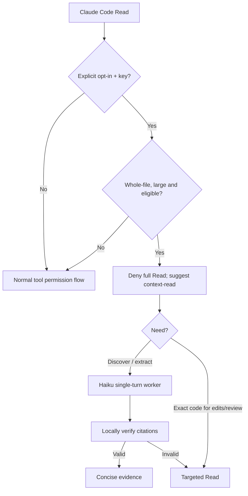

# ADR-022 — Opt-in, bounded Context Shunt for large source reads

**Status:** Proposed  
**Date:** 2026-11-01  
**Related:** ADR-001, ADR-005, ADR-007, ADR-013, ADR-023

## Context

Whole-file reads may consume expensive primary-model context when the task only needs targeted extraction. Spotify's shunt pattern demonstrates deterministic `PreToolUse` routing to a smaller worker. Our existing reviewers need exact code and executed checks; summaries cannot replace that evidence.

## Decision

1. Add a plugin `PreToolUse` hook for `Read` only. It is **off by default**: `AI_DEV_TOOLS_CONTEXT_SHUNT=1` plus `ANTHROPIC_API_KEY` is required. The hook makes no network calls.
2. Deterministically identify eligible whole-file reads: over 350 lines by default, at most 6 files/240,000 source bytes per worker call, regular UTF-8 workspace-confined files, not symlinks, with path-based exclusions for likely secrets. Failure to qualify leaves the existing permission flow unchanged.
3. Return a `deny` decision with instructions to invoke `/ai-dev-tools:context-read` or use `Read` with `offset`/`limit`. Never return `allow` or silently modify the tool invocation.
4. A separate explicit command runs one ephemeral read-only Anthropic Messages request to Haiku 5.5 by default (configurable model). No worker filesystem or write tools. All eligible source content is transferred to Anthropic, so opt-in is an explicit trust boundary.
5. Verify source references before accepting a result (ADR-023). A worker failure yields no answer; exact source reads and tests remain authoritative.
6. Do not attempt shell-command parsing or automatic interception of `@` prompt file references in this MVP. This is a context optimizer, **not** a DLP enforcement mechanism.

## Flow

## Alternatives

- Prompt-only guidance: easy, but voluntary and inconsistent.
- Automatic API call in a hook: rejected; the hook lacks a focused question and should not surprise users with network I/O.
- Intercept every Bash read: rejected until reliable parsing exists; broad interception can damage developer workflows.
- Reuse autonomous-dev-loop's CI provider router: rejected as a tightly coupled dependency between two different execution environments.
- Enabled by default: rejected due to confidentiality, latency and unproven end-to-end cost advantage.

## Consequences

Selective source extraction can reduce primary-model context usage while preserving existing human gates, tests and reviews. Additional Anthropic API credentials/cost and latency are required. Plugin hooks activate with plugin installation, not merely by onboarding that copies commands. Evaluate representative workflows before broader rollout. This ADR is proposed until its PR is merged.
