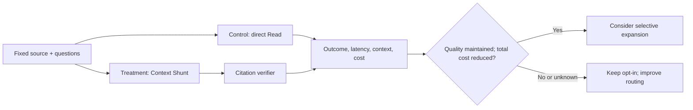

# ADR-023 — Verified source evidence and honest Context Shunt economics

**Status:** Proposed  
**Date:** 2026-11-01  
**Related:** ADR-009, ADR-016, ADR-022

## Context

A worker can return plausible but fabricated citations. Even a genuinely quoted source line may not prove its interpretation. And a smaller primary-model context is not necessarily a lower total bill once worker input/output, prompt caching, retries and latency are considered.

## Decision

1. Require parseable JSON: `summary` (up to 3,000 characters) plus 1–12 `{path,line,quote}` citations. Verify every quote as a literal substring of the cited **1-based line from the same local snapshot**. Reject missing, incorrect or truncated results; no partial success.
2. The verifier establishes **quote provenance**, not logical entailment. Workers are only evidence extractors. Architectural decisions, patch editing, review, CI and merge gates continue to use original sources and executed results.
3. Record model, actual provider input/output/cache usage, source and returned character counts. Do not record questions, file paths or source text in the structured stderr event.
4. Label `source_chars` and `returned_chars` as **proxies**, not billed tokens or dollar savings. No price table is baked into this MVP, and it does not see Claude Code's counterfactual token bill.
5. Benchmark fixed tasks with and without delegation: verified citation accuracy, task outcome, total cost (including cache and worker), latency, failures and context growth. Only expand routing after **quality non-inferiority and measured end-to-end savings**.

## Measurement loop

## Alternatives

- Trust generated citations: rejected; path/line/quote verification is cheap and deterministic.
- Treat a verified quote as a verified conclusion: rejected; semantics require separate validation.
- Reuse Spotify's published token-saving percentage as our estimate: rejected; the corpus, providers and work differ.
- Persist worker summaries: deferred, as invalidation and sensitive-data storage require their own decision.

## Consequences

The runtime provides auditable source references and measured worker usage, without claiming that summaries are independently correct or that total costs fell. Failed delegations leave normal targeted reads available.
