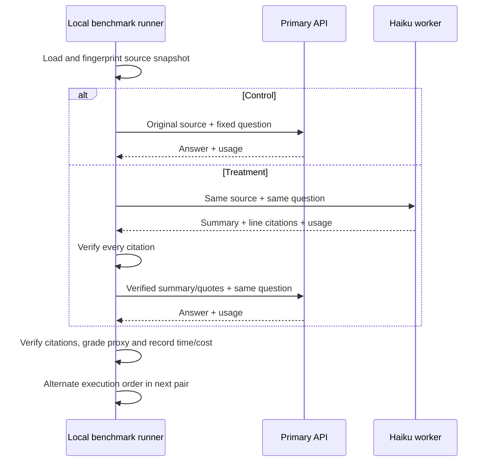

# ADR-024 — Paired, opt-in A/B evaluation of Context Shunt economics

**Status:** Proposed  
**Date:** 2026-11-01  
**Related:** ADR-009 (tool evidence), ADR-022 (bounded delegation), ADR-023 (verified quotes and measurement)

## Context

ADR-022 introduced a source extractor and an optional large-read Claude Code hook, but the 82–94% primary-model token savings in Spotify's benchmark cannot be assumed to transfer to this repository. Optimizing local context may increase billed API usage or latency. Provider selection and factual accuracy also affect outcomes.

## Decision

1. Build an **explicit** CLI benchmark with an offline plan by default. Network requests require `--live`, `AI_DEV_TOOLS_CONTEXT_SHUNT=1` and `ANTHROPIC_API_KEY`. It is intentionally excluded from CI and scheduled automation.
2. For every fixed question and local source snapshot compare:
   - **Control:** full source lines -> primary Anthropic model -> summary and exact citations.
   - **Treatment:** same source lines -> existing Context Shunt Haiku worker -> verified evidence -> **same primary model**, same response contract.
3. Validate primary-model citations deterministically against the original files in both arms. Measure weak phrase-based quality proxies from predefined cases, but **never report them as semantic correctness**. Human review is required to establish non-inferiority.
4. Use serialized paired cross-over order (AB/BA by case/repeat), bounded to 6 cases and 3 repetitions. Source inputs stay within the Context Shunt scope and byte limits. Capture success/failure **including failures**; do not silently discard unsuccessful treatment runs.
5. Collect per-call provider-reported input/output/cache usage, wall time, and actual reported model ID. Allow a **user-supplied** USD/MTok price table; never silently substitute a model's price or treat missing pricing as free.
6. Publish only non-sensitive metrics, case IDs and source fingerprints, not prompts, code, quotes, file paths, response text or API credentials. Pin code revision in the report. Local output must be explicitly requested and never overwrite existing files.
7. This experiment is a **standalone Anthropic API proxy** for the savings hypothesis, *not* an instrumented Claude Code integration. Primary API input tokens are not the same as Claude Code session context or subscription billing. Results cannot substantiate those broader claims.

## Protocol

## Alternatives

- **Only compare source and returned character counts:** rejected; output lengths say little about billed price or quality.
- **Use two different primary models:** rejected; model ability would confound read strategy.
- **Trigger paid model calls automatically in CI:** rejected; cost, external data transfer and nondeterminism require explicit action.
- **Treat exact quote verification as semantic correctness:** rejected; line provenance does not prove a conclusion.
- **Commit hardcoded vendor prices:** rejected; price changes and cache discounts require verified user-supplied rates.
- **Run a full Claude Code session in each arm:** deferred; would require host integration, instrumentation and stable per-session usage records.

## Rollout gates

A favorable treatment must maintain human-verified answer quality across representative cases and show a lower **end-to-end** total API cost, acceptable latency, and no significant increase in failures over repeated runs. Missing cost data, weak proxy grading and insufficient sample size yield **inconclusive**, never automatic approval. Keep the shunt off by default.

## Consequences

An auditable local harness allows model-routing choices to be based on data rather than vendor percentages. The result is limited to the selected sources, models and Anthropic API, and carries known proxy and caching limitations.
