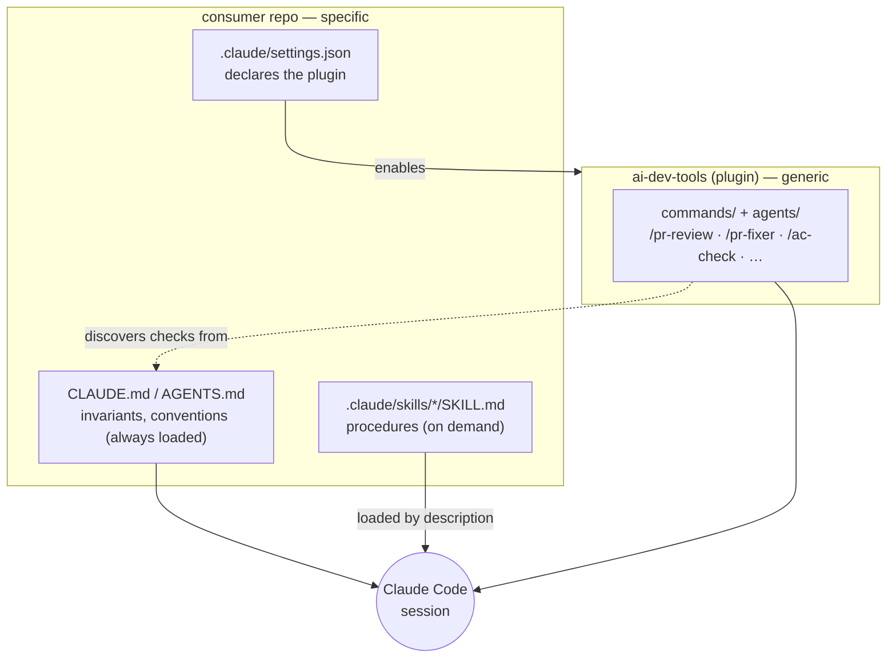
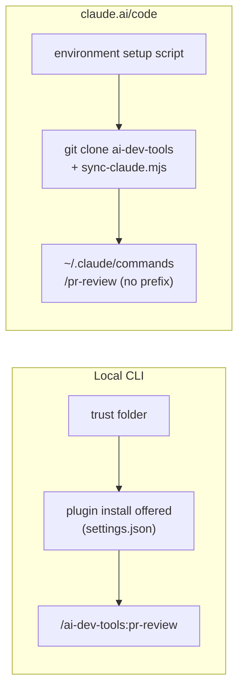

# Consumer repositories

How a repository adopts ai-dev-tools and keeps its own procedures. Decision: [ADR-018](adr/ADR-018-consumer-repo-adoption.md). Distribution mechanics: [ADR-013](adr/ADR-013-plugin-distribution-and-script-paths.md).

## Layers

Narrowest wins: a repo rule or skill overrides a toolbox default.

## Local vs cloud

Cloud sessions do not install repository-declared plugins, so the setup script is the only path there (README → *Use from another repository*). In a multi-repository session, `CLAUDE.md` and skills of every repo load; hooks and permissions do not.

## Adopting it in a repo

1. Copy the two keys of ADR-013 §2 into `.claude/settings.json`.
2. Put invariants in `CLAUDE.md` / `AGENTS.md`; put multi-step procedures in `.claude/skills/<name>/SKILL.md` (`name` + `description`).
3. Add a `## Toolbox` section to `CLAUDE.md` and a `docs/claude-code.md`; record an ADR if the repo has an ADR practice.

## Handoff from the loop's `needs-human`

A PR that autonomous-dev-loop escalates (`needs-human`) is the entry point of Level 1. For a merge conflict (`conflicts-fix`, loop ADR-0059) the comment names the files and the reason (`protected_path`, `model_rejected`, `guard_rejected`, …): merge the base by hand, then `/pr-review` and `/pr-fixer` resume the PR. Both read `mergeable` from `gh-get-pr.mjs`: `/pr-review` flags a `CONFLICTING` PR in its report, `/pr-fixer` stops with `NEEDS_REVIEW` until the conflict is resolved, because fixes written on a stale base do not apply once the base is merged.

## Current adopters

| Repo | Skills | Docs |
|---|---|---|
| `autonomous-dev-loop` | `edit-guardrails`, `test-protocol`, `changelog-gate`, `observability-contract`, `pr-review-workflow`, `new-adr` | `CLAUDE.md` |
| `sync-engine` | `new-adr`, `add-sync-module` | `docs/claude-code.md`, ADR-006 |
| `fullstack-pilot` | `validate-change`, `github-artifacts`, `new-adr` | `docs/claude-code.md`, ADR-006 |
| `agent-patterns` | `new-pattern` | `docs/claude-code.md` |
| `koydas` | `site-change` | `docs/claude-code.md` |
