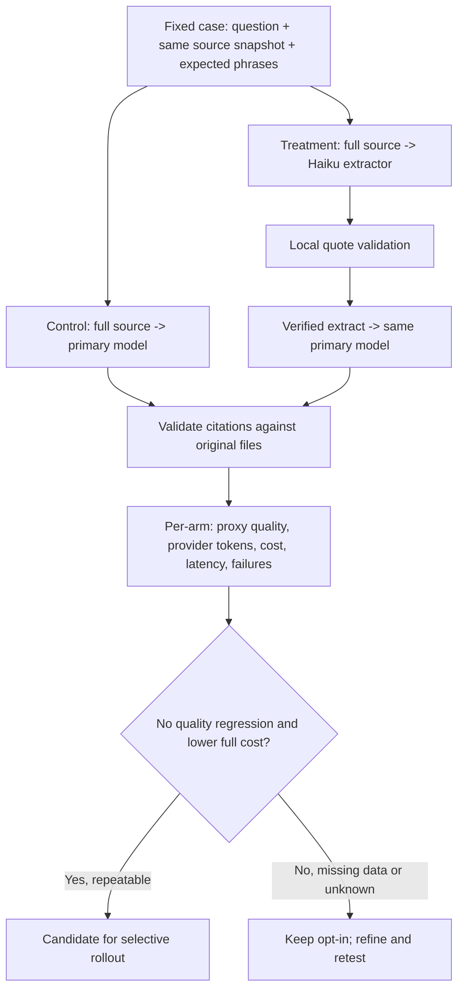

# Context Shunt — reproducible A/B benchmark

**Status:** explicit, opt-in, standalone Anthropic API experiment. [ADR-024](adr/ADR-024-context-shunt-benchmark.md) · [Context Shunt architecture](context-shunt.md).

The benchmark compares **the same primary model answering the same question** using either the original source (control) or **a locally verified Haiku evidence extract** (treatment). Both arms are invoked against Anthropic's API. The benchmark **does not** measure Claude Code's internal session context or compare subscription charges.

## Test design



The primary model, output contract, source snapshot, question and temperature defaults are the same. The treatment adds a worker call. The cases alternate direct-first and shunt-first by case/repetition to reduce ordering bias; each pair runs serially, so external service load and cache warming remain confounders.

## Commands

Requires Node 20+, a checked-out copy of `ai-dev-tools`, and authorization to send selected files to Anthropic. Run from the **repository being benchmarked** (the default case set assumes the ai-dev-tools repository).

```bash
# No network call. Shows maximum planned API requests and sample count.
node scripts/context-shunt-benchmark.mjs

# Live calls: direct + worker + primary = up to 3 requests per case/repetition.
# Do not commit the API key, pricing input with proprietary information or any reports.
export AI_DEV_TOOLS_CONTEXT_SHUNT=1
export ANTHROPIC_API_KEY="..." # secure environment/secret manager
node scripts/context-shunt-benchmark.mjs --live \
  --cases benchmarks/context-shunt/cases.json \
  --model claude-sonnet-5-5 \
  --repeats 2 --output /tmp/context-shunt-ab.json
```

**Limits:** 1–6 cases, 1–3 repeats, 6 source files and 240,000 bytes maximum per case; no implicit retries. Output is created exclusively, with file mode 0600 on systems supporting it. If any case path is unsafe, invalid, missing or out of scope, validation fails **before any network request**. The tool **never runs live** unless `--live`, `AI_DEV_TOOLS_CONTEXT_SHUNT=1` and `ANTHROPIC_API_KEY` are all present.

## Case dataset

`benchmarks/context-shunt/cases.json` contains representative questions about the existing toolbox. The format is:

```json
{
  "cases": [{
    "id": "review-gates",
    "question": "What evidence permits DONE?",
    "paths": ["README.md"],
    "must_include": ["PASS", "N/A", "PRE_EXISTING"]
  }]
}
```

Each `must_include` phrase must appear in the **primary-model summary**, case-insensitively; source citations must match the actual source snapshot. These phrase tests are **a deterministic, weak quality proxy**. They do **not** establish semantic correctness or validate every relevant fact. A human should inspect actual model answers in a separately authorized, private evaluation to determine non-inferiority. Deliberately avoid publishing source excerpts or questions in benchmark metrics.

The result contains case IDs, source SHA-256 fingerprints, revision, token usage, latency, pass/fail flags and error **types only**. It does not retain prompts, raw answers, file paths, quotes or source code. Fingerprints allow detecting changes between datasets, but do not substitute for pinning a Git commit.

## Pricing and cost accounting

No prices are hardcoded; an unpriced result is **`null`**, not `0`. To compare USD cost, create a local JSON file based on `benchmarks/context-shunt/pricing.example.json` and enter verified, dated **USD per million tokens** for both exact model IDs:

```json
{
  "models": {
    "claude-sonnet-5-5": { "input": 0, "output": 0, "cacheRead": 0, "cacheWrite": 0 },
    "claude-haiku-5-5": { "input": 0, "output": 0, "cacheRead": 0, "cacheWrite": 0 }
  }
}
```

**The numbers above are schema placeholders, not rates** — replace all zeros with current provider prices. Set any genuinely free category to zero only when verified. Never copy this example as a cost estimate.

```text
Control total = primary input + output + cache terms
Treatment total = worker input + output + cache terms
                + primary input + output + cache terms
```

Use `--pricing path/to/local-pricing.json` with `--live`. If pricing or billable usage is incomplete, the affected cost stays `null`. On failed calls, provider charges may be unknown and should not be inferred to be zero. This experiment observes **API response usage**, not an independently reconciled invoice. Context-char proxies from the separate shunt command are not billable tokens.

## Result interpretation

| Field | Meaning |
|---|---|
| `ok` | One arm completed and its primary output had structurally valid, source-verified citations |
| `proxy_pass` | `ok` plus every case-specific required phrase appeared in the primary summary |
| `calls[].usage` | Provider-reported token counts, separated into worker/primary calls |
| `cost_usd` | Sum of priced API usage, or null when unavailable/unknown |
| `summary.*.primary_input_tokens` | Primary API input token consumption, not Claude Code UI context size |
| `latency_ms` | Wall-clock time for the arm, inclusive of network and worker call |
| `failure_type` | Error class only; no raw API body or code text in report |

**Success requires more than a numerical win:** high-quality human review of a representative sample, no increase in missed facts, and a repeatable reduction in total priced API cost without unacceptable latency. Do not generalize beyond this corpus or infer a measured benefit for Claude Code itself.

## Offline validation

```bash
node --test tests/context-shunt-benchmark.test.mjs
node --test
```

Unit tests mock both providers, verify the cross-over order, cost math, bounds, grading, and source-free reports. No real API benchmark is shipped as CI, and **no paid API call** occurs in the default workflow.
