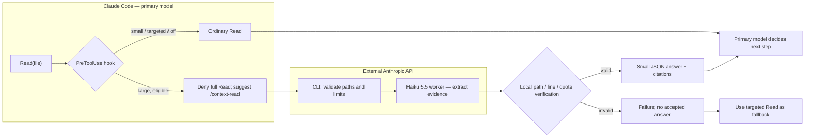

# Context Shunt — bounded, read-only worker delegation

**Status:** opt-in MVP. **Decisions:** [ADR-022](adr/ADR-022-context-shunt.md) · [ADR-023](adr/ADR-023-context-shunt-evidence.md). **Command:** [/context-read](commands/context-read.md).

Context Shunt reduces **primary-agent context pressure** when an agent wants to scan large source files for a focused answer. A deterministic Claude Code hook suggests delegating large whole-file reads to a cheaper model, then a separate CLI invokes one read-only worker and validates its source citations. It does **not** replace review, editing, CI evidence, or human approval.

## Overview



**Separation:** The hook runs synchronously and **never calls the API**. The model decides whether the blocked full read is a discovery task appropriate for delegation or an exact-reading task that requires offsets. The CLI is the only network caller.

## Enable

The hook is packaged under `hooks/hooks.json` and is discovered when **the ai-dev-tools Claude Code plugin is installed**. Copying commands with `onboarding.mjs` or `sync-claude.mjs` alone does not activate plugin hooks. An explicit manual CLI call works from any trusted local checkout.

```bash
# In your terminal (not in repository files):
export AI_DEV_TOOLS_CONTEXT_SHUNT=1
export ANTHROPIC_API_KEY="your-api-key" # obtain from Anthropic Console

# Optional: tune eligibility and worker model.
export AI_DEV_TOOLS_CONTEXT_SHUNT_MIN_LINES=350
export AI_DEV_TOOLS_CONTEXT_SHUNT_MODEL=claude-haiku-5-5

# From the repository being investigated:
node /path/to/ai-dev-tools/scripts/context-shunt.mjs \
  --question "Which function validates the incoming token?" \
  --paths src/auth.ts src/session.ts --json
```

The API key is **separate from a Claude Code or Claude Pro subscription**. Your session must be allowed to transmit the selected source to Anthropic. Do not put secrets in `CLAUDE.md`, committed YAML, or pull requests. Unset `AI_DEV_TOOLS_CONTEXT_SHUNT` to disable routing immediately.

## Decision rules

| Case | Hook outcome |
|---|---|
| Disabled or no Anthropic API key | No decision; ordinary permissions |
| `Read` with offset or limit | No decision; exact targeted read |
| File ≤ configured line threshold | No decision |
| Large workspace file, UTF-8, eligible | **Deny** and direct to `/ai-dev-tools:context-read` |
| Missing, oversized, binary, symlinked, external or sensitive by path | No decision; do **not** auto-send |
| Bash, MCP file reads, `@` prompt references | Not intercepted |

The worker itself validates every requested path. All paths must resolve inside the **current working directory**; it rejects parent traversal and absolute paths pointing elsewhere, symlinks, non-files, binary / invalid UTF-8, repeated paths, excluded secret-like paths and over-limit requests. Defaults: **6 files and 240,000 total source bytes**, with a per-Read line threshold of **350**. The hook skips files too large to delegate rather than trapping the agent.

Secret protection here is **path-based**, not a content-level DLP system. A permitted file can still contain credentials, proprietary code or regulated data. Never enable this on content you are not allowed to send externally.

## Data and trust boundaries

```mermaid
sequenceDiagram
    participant Claude as Claude Code
    participant Hook as PreToolUse Hook
    participant CLI as Local Context Shunt
    participant Worker as Anthropic Haiku API
    Claude->>Hook: Read(path) requested
    Hook->>Hook: Check opt-in, size, path, scope
    alt Not eligible
      Hook-->>Claude: No decision
    else Large eligible source
      Hook-->>Claude: Deny + route suggestion
      Claude->>CLI: Specific question + path list
      CLI->>CLI: Validate files; attach line numbers
      CLI->>Worker: Question + selected file contents
      Worker-->>CLI: Summary + quoted path:line references
      CLI->>CLI: Verify every quoted substring
      alt All citations valid
        CLI-->>Claude: Compact JSON + verified citations
      else Missing or unverifiable evidence
        CLI-->>Claude: Explicit error; no summary
      end
    end
```

Source content is **untrusted data** in the worker prompt; the worker receives no tools and cannot mutate the repository. Returned quotes are checked against the same in-memory files used to build the request. Quotes matching lines does **not** establish that the model's interpretation is correct. The primary model uses targeted reads and existing tests for anything consequential.

The CLI emits an event on stderr with `event=context_shunt.complete`, `model`, actual provider token usage (when reported), and numeric `source_chars`/`returned_chars` proxies. No source paths, source content, user question, or API key are intentionally logged by that event. API-level logs/data policies are governed by the provider.

## Failure and scope

- Worker HTTP failure: non-zero exit, no retry.
- Timeout: 90 seconds. Truncated response, invalid JSON or bad quote: rejected.
- An answer with no verified citations: rejected, rather than quietly treated as evidence.
- For exact edits or PR reviews: use **`Read` with offset/limit** and maintain executed tests and reviewer quality gates.
- The default hook intentionally does **not** block `Bash` whole-file reads. This is a performance optimization, not access control.

## Evaluation plan

Run identical, fixed questions on a representative repository using (a) direct reads and (b) Context Shunt. Record:

| Measure | Why it matters |
|---|---|
| Factual correctness and verified citation rate | Delegation must not degrade task quality |
| Primary Claude Code context growth | Measures the benefit we are targeting |
| Worker API input/output/cache tokens | Captures additional tokens from delegation |
| End-to-end USD cost | Compare real model prices and caching; do not reuse a vendor benchmark |
| End-to-end latency, errors, fallback frequency | Prevent latency or failure regressions |

The current runtime reports **worker usage**, not the full baseline or Claude Code billing. Character-count proxies are **not token bills**. No cost reduction percentage is claimed until evaluated with equivalent tasks. Future selective routing can reuse the result, without coupling the context extractor to `autonomous-dev-loop`.

## Offline tests

```bash
node --test tests/context-shunt.test.mjs
node --test
```

Tests mock the provider transport. They cover opt-in, hook deny/no-decision behavior, path/symlink/secret exclusions, input limits, citation verification, worker usage and error handling. A live benchmark requires a separate explicit opt-in and credentials.
